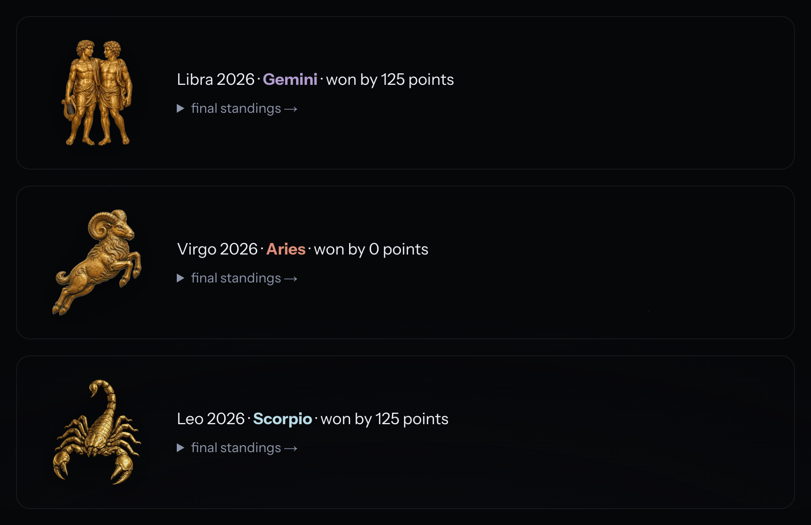
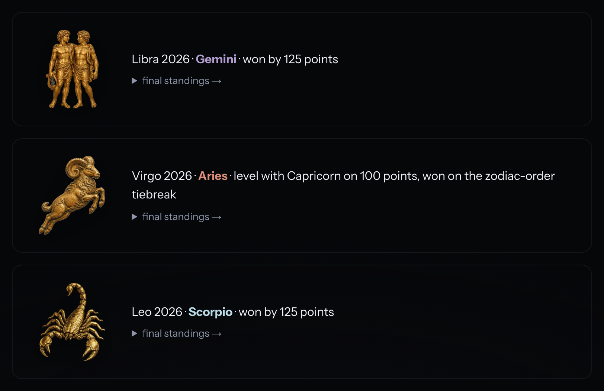
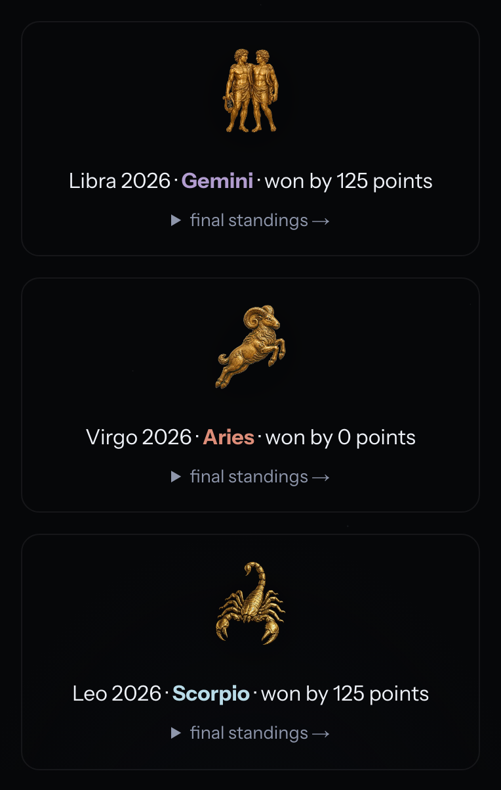
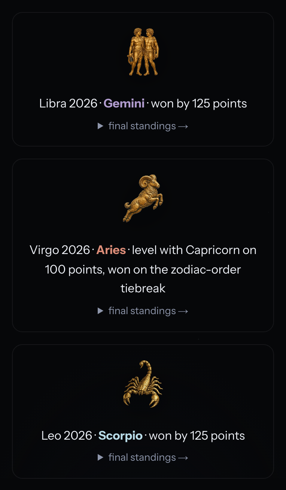
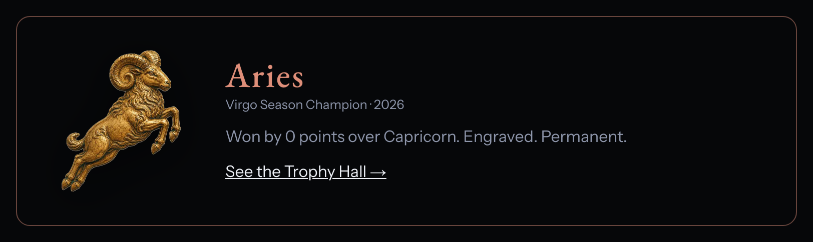
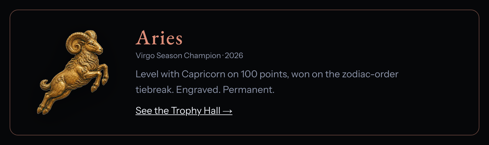
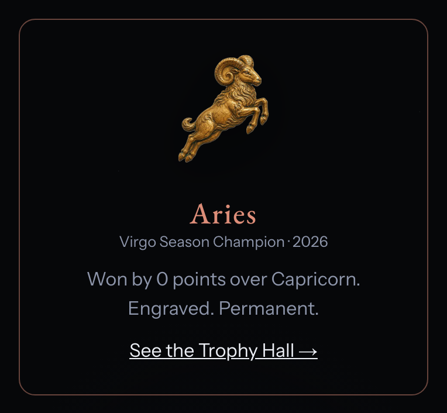
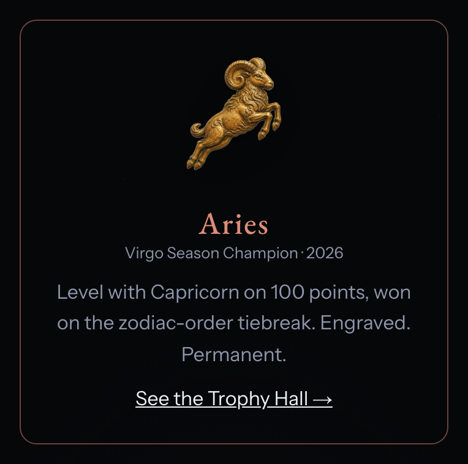

# Race tie wording, November 4, 2026

A Race season that ends level on points is engraved with `marginPoints: 0`,
and the Trophy Hall and the champion announcement on /race/ printed "won by 0
points". They now say the season was level on points and won on the
zodiac-order tiebreak.

Virgo 2026 is the first such season: Aries and Capricorn finished on 100
points each. Equal points rank in zodiac order, Aries first, so Aries is the
champion.

## How these were captured

- Tie fixture: `src/data/games/champions.json` from main at `43b88e7d`, with
  virgo-2026 and libra-2026 appended by the close workflow's own
  `engraveSeasons` from the archived standings that
  `https://zodiacs.org/api/games?action=standings&season=<id>` served at 15:59
  ICT on November 4, 2026. These are the entries the next Race Season Close
  run writes. The fixture was not committed.
- A production `astro build` of each tree with `PUBLIC_ZODIAC_GAMES_ENABLED=1`
  and the build clock set to 12:00 ICT on October 10, 2026. /race/ announces
  the season that closed most recently, so on that date it shows Virgo 2026.
  Built on November 4 it shows Libra 2026, Gemini by 125 points, which reads
  as it did before.
- Before: main at `43b88e7d`. After: the `fix/race-tie-wording` branch.
- Chromium 149.0.7827.55 through Playwright 1.61.1, at 1280 by 900 and 390 by
  844 CSS pixels, device scale 2. Each image is the Hall list or the champion
  block.

## /games/history/

| Width | Before | After |
| --- | --- | --- |
| 1280 |  |  |
| 390 |  |  |

## /race/

| Width | Before | After |
| --- | --- | --- |
| 1280 |  |  |
| 390 |  |  |
